---
name: client-onboarding-and-care-management
description: >-
  Standard operating procedures for 14-day client delivery sprints, DNS cutover, and ongoing Care Plan SLA management.
  Use whenever managing client projects in `/admin/clients`, onboarding a new trade client, assisting with DNS connection, or resolving care plan tickets.
---

# Client Onboarding & 14-Day Delivery Sprint (Harley Digital Works)

This skill outlines the strict 14-day delivery sprint, DNS connection workflows, and Managed Care Plan standards for **Harley Digital Works**.

---

## The 14-Day Delivery Sprint Schedule

```mermaid
gantt
    title 14-Day Rapid Delivery Sprint
    dateFormat  D
    axisFormat  Day %d
    section Discovery & Copy
    15-Min Intro Call & Target Intake       :active, 1, 2
    Full Copywriting & Asset Curation       :3, 5
    section Design & Build
    Interactive Prototype Build             :6, 9
    Quote Estimator & Schema Config         :9, 11
    section Sign-Off & Launch
    Client Walkthrough & Polish             :12, 13
    DNS Cutover & Google Submission         :14, 14
```

### Day-by-Day Milestone Execution:
- **Day 1–2 (Discovery & Setup)**: Collect business name, trade certifications, coverage postcodes, and deposit invoice (£747.50 + VAT). Create client record in `/admin/clients` and provision token on `/track/$token`.
- **Day 3–5 (Copywriting & Architecture)**: Write all landing page copy, FAQs, regional landing pages, and select high-res trade photography.
- **Day 6–10 (Technical Build & Interactive Tools)**: Build responsive views (Mobile, Tablet, Desktop), connect click-to-WhatsApp, before/after slider, and trade quote calculator.
- **Day 11–13 (Review & Polish)**: Send private preview link to client. Conduct 15-minute feedback walkthrough. Implement any requested text adjustments.
- **Day 14 (Launch & DNS Cutover)**: Collect final balance invoice (£747.50 + VAT). Point A-record / CNAME to server. Submit sitemap to Google Search Console. Activate £95/mo Care Plan.

---

## DNS Cutover Guidelines

Instruct the client or manage their DNS records using these standard parameters:

| Record Type | Host / Name | Target / Value | TTL |
|---|---|---|---|
| **A Record** | `@` (or apex domain) | `172.67.182.20` | Auto / 300 |
| **CNAME** | `www` | `cname.harleydigitalworks.com` | Auto / 300 |

### Common Registrar Instructions:
- **GoDaddy**: DNS Management → Add Record → Select `A` / `CNAME`.
- **123-Reg**: Manage Domain → Advanced DNS → Add Record.
- **Namecheap**: Advanced DNS → Host Records → Add New Record.

---

## Managed Care Plan SLAs (£95/mo & £195/mo)

1. **Turnaround Time**: Text and image update requests sent via WhatsApp or email must be completed within **24 business hours**.
2. **Backups & Security**: Automated daily cloud backups retained for 30 days. SSL auto-renewal monitored 24/7.
3. **Monthly Reporting**: Summary of website traffic, click-to-call events, and quote calculator submissions sent to the client at the end of each billing cycle.
