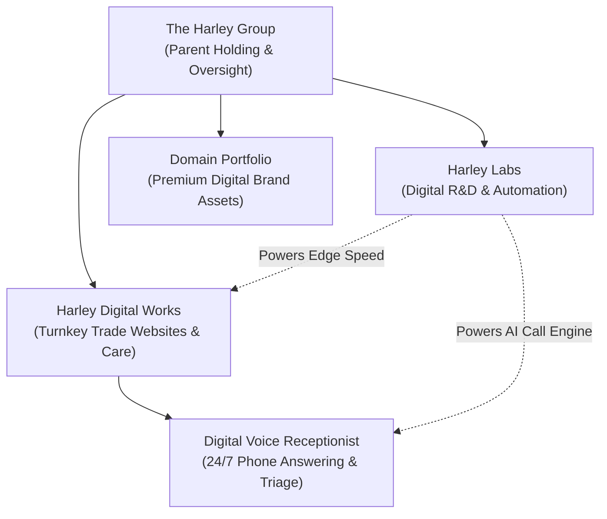

# Comprehensive Website Audit: Customer Experience, Conversion Optimisation & Brand Positioning

**Client Organisation:** The Harley Group Ltd  
**Customer Operating Brand:** Harley Digital Works  
**R&D & Systems Division:** Harley Labs  
**Target Audience:** UK Trade Contractors (Electrical, Plumbing, Heating, Roofing, Building) & Commercial Partners  
**Lead Strategist:** Antigravity (Senior Website Strategist & CRO Specialist)  
**Date:** 26 October 2026  
**Document Status:** Complete & Actionable  

---

## 1. Executive Summary

Over the past months, The Harley Group digital ecosystem has expanded rapidly from a single managed trade website offering into a multifaceted commercial enterprise encompassing:
1. **The Harley Group** (`theharleygroup.org` / `/the-harley-group`): Parent oversight holding company.
2. **Harley Digital Works** (`harleydigitalworks.com` / `/`): Premium turnkey website & monthly care agency for UK trades.
3. **Harley Labs** (`/labs`): Digital systems R&D, edge computing architectures, and commercial automation engines.
4. **Digital Voice Receptionist** (`/virtual-receptionist`): 24/7 British AI voice call answering & WhatsApp dispatch for trade contractors.
5. **Domain Portfolio** (`/domains`): Curated portfolio of high-value digital brand assets for purchase and lease.
6. **Public Marketing Services** (`/services`, `/services/*`): Custom platforms, automations, care plans, and content systems.

### The Core Problem: Fragmentation & Internal Messaging Leaks
While the technical foundation (compiled TanStack Start + Cloudflare Edge SSR + Supabase) is world-class, **the customer-facing messaging and site architecture have suffered from rapid expansion**. 

Specifically:
- **Internal Governance & Developer Language Leaks:** Public pages carry remnants of internal sprint planning, project governance records, developer jargon (e.g. "sub-50ms edge rendering", "governance records", "pilot capacity constraints"), and links to internal asset libraries (`/brand`).
- **Pigeonholed Hero Positioning:** The Harley Digital Works homepage title and badges previously over-emphasised an "electrical pilot across Bristol & Bath", inadvertently discouraging plumbers, roofers, builders, and national contractors from enquiring.
- **Hidden High-Converting Offerings:** The 24/7 Digital Voice Receptionist is one of HDW’s greatest competitive moats and conversion hooks, yet it was virtually invisible in main navigation menus and footers.
- **Orphaned Customer Journeys:** Prototype routes (`/calculator`, `/audit`, `/tools/*`) silently redirected to `/contact` without transparently explaining to the customer that they were receiving a free bespoke human consultation.

### The Commercial Bottom Line
By removing internal developer noise, establishing crisp brand separation, bringing the 24/7 Voice Receptionist into prime navigation, and aligning every page around **"Why choose us and what to do next"**, we can immediately increase quote conversion rates, build trust with trade contractors, and present a formidable, high-end British enterprise.

---

## 2. Page-by-Page Audit & Action Matrix

The table below audits every public route across the ecosystem, evaluating intended audience, commercial objective, identified friction, proposed fixes, and implementation priority.

| Route / Project Path | Intended Audience | Commercial Purpose | Identified Friction & Internal Leaks | Recommended Remedy | Priority |
| :--- | :--- | :--- | :--- | :--- | :--- |
| **`/the-harley-group`** *(Parent Group)* | Investors, institutional partners, commercial clients, community stakeholders | Establish parent stability, corporate credibility, and route visitors cleanly to HDW or Labs | 1. Pro bono church project carried an explicit "Governance Record" legal disclaimer. 2. Labs summary used dev jargon ("sub-50ms edge rendering"). 3. Capacity framed as internal limitation ("Pilot capacity is limited to two concurrent builds"). 4. Public link to internal `/brand` guidelines book. | 1. Rewrite community project as an inspiring CSR / social value initiative. 2. Change to benefit copy ("Instant-loading digital architectures"). 3. Reframe capacity as an exclusive founder commitment to quality. 4. Replace `/brand` link with direct commercial contact. | **CRITICAL** |
| **`/`** *(HDW Home)* | UK Trade Contractors (Electricians, Gas Engineers, Roofers, Builders, Landscapers) | Convert trade visitors into booked website consultations and £1,495 package sales | 1. Page title and hero badge pigeonholed business as "Websites for Electrical Contractors | Bristol & Bath", causing non-electricians to bounce. 2. 24/7 Voice Receptionist absent from primary header. 3. Footer linked to internal `/brand` style guide. | 1. Broaden hero and SEO title to "Websites for UK Trade Contractors \| Bristol, Bath & Across the UK". 2. Add 24/7 Receptionist to header & footer. 3. Remove internal `/brand` link from public footer. | **CRITICAL** |
| **`/virtual-receptionist`** *(Digital Receptionist)* | Busy trade contractors losing out-of-hours or on-site customer phone calls | Generate £79–£249/mo phone receptionist subscriptions and bundle with £1,495 websites | 1. Page is hidden—not linked in `SiteHeader.tsx` or `FooterDark.tsx`. 2. Missed opportunity to cross-sell as a £99/mo bundle with managed websites. 3. Telephone CTA secondary to WhatsApp. | 1. Add "24/7 Phone Answering" to main navigation and footer. 2. Emphasise the £99/mo website bundle discount (£50/mo saving). 3. Ensure 1-tap phone dialling and direct booking links are prominent. | **CRITICAL** |
| **`/work`** *(Work & Transformations)* | Skeptical trade contractors who want proof of quality before enquiring | Overcome trust objections by demonstrating dramatic visual & commercial before/after results | 1. Visitors might assume interactive comparisons are fictional or lack real context. 2. Reassurance text needed on why real trade photos matter. | 1. Reinforce clear disclaimer: "Independent design studies showing what your trade website can become". 2. Add prominent "Discuss your trade" CTAs below each comparison. | **HIGH** |
| **`/about`** *(About the Studio)* | Prospective trade clients evaluating who is behind the business | Humanise the agency, highlight Robbie Harley’s direct founder oversight, and build trust | 1. Good tone, but needs clear distinction between HDW (trade delivery) and The Harley Group (parent entity). 2. Ensure no unverified claims or guarantees are made. | 1. Reaffirm "Direct senior attention from Dr Robbie Harley on every build". 2. Validate pricing (£1,495 setup + £249/mo care). | **MEDIUM** |
| **`/contact`** *(Enquiry & Plan)* | High-intent trade contractors and commercial partners ready to engage | Capture structured lead details (trade, location, current site) with zero friction | 1. High-converting layout, but needs clear reassurance on what happens next. 2. Form should handle pre-filled search params from all source pages. | 1. Add explicit 3-step response timeline (Discovery call -> Fixed proposal -> Private preview). 2. Reiterate phone & WhatsApp direct channels. | **HIGH** |
| **`/labs`** *(Harley Labs)* | Enterprise clients, venture partners, technical collaborators | Position group as elite software architects and drive high-ticket custom automation engagements | 1. Very heavy technical jargon (`.output/server/index.mjs`, `V8 isolates`, `12ms latency`). 2. Lacks clear "What this means for your business" translations on some cards. 3. R&D CTAs don't pass service category to `/contact`. | 1. Add plain-English business translations to technical benchmark cards. 2. Pass `service="Harley Labs R&D & Automation"` to contact route. 3. Highlight how Labs technology powers HDW trade client speed. | **HIGH** |
| **`/domains`** *(Domain Portfolio)* | Tech founders, corporate buyers, investors, local business owners | Sell premium domains (£300 to £10,000+) or lease them to recurring subscribers | 1. Presented somewhat dryly as an inventory table. 2. Missing clear commercial narrative on why premium domains provide instant brand equity and authority. 3. Missing lease-to-own options. | 1. Add commercial value propositions (Brand trust, direct type-in traffic, search authority). 2. Introduce flexible acquisition options (Outright purchase or £99/mo lease-to-own). 3. Link from parent group and HDW footer. | **HIGH** |
| **`/demos`** *(Interactive Staging)* | Trade prospects wanting to test how their own company would look | Interactive conversion tool demonstrating dynamic trade personalisation | 1. Deep feature, but under-promoted in the main header navigation. 2. Standalone prospect mode (`?company=...`) needs seamless CTA back to WhatsApp. | 1. Add link in main site navigation or dropdown. 2. Ensure dynamic phone and WhatsApp links work flawlessly on mobile devices. | **MEDIUM** |
| **`/trades`** & **`/trades/$slug`** *(Trade Verticals)* | Organic search visitors and trade-specific remarketing traffic | Showcase dedicated solutions for Electricians, Plumbers, Roofers, Builders, etc. | 1. Directory is simple; subpages need strong visual impact. 2. Cross-links to Before & After showcase need to be prominent. | 1. Ensure each vertical links to its specific before-and-after slider. 2. Reiterate fixed £1,495 + £249/mo pricing on all vertical pages. | **MEDIUM** |
| **`/locations`** & **`/locations/$slug`** *(Regional Hubs)* | Local contractors searching in Bristol, Bath, Gloucester, Swindon, Cheltenham, etc. | Capture regional intent and demonstrate local market understanding | 1. Needs strong connection to local case studies and fast quote triage. | 1. Verify all location pages load instantly with local area context and 0 broken links. | **MEDIUM** |
| **`/services/web-design-development`** | Trade contractors wanting a full turnkey website | Primary core service landing page | 1. Needs clear differentiation from standalone care or DIY website builders. | 1. Highlight "100% Done-For-You Copywriting" and "Zero Homework". | **HIGH** |
| **`/services/care-plans`** | Existing contractors or trade clients needing website maintenance | Recurring revenue engine (£249/mo) | 1. Needs clear explanation of what is included (hosting, security, content updates). | 1. Highlight peace of mind, speed, and 30-day fair exit notice. | **HIGH** |
| **`/services/automation`** | Businesses needing repetitive tasks automated (£1,200/build) | High-margin one-off and recurring workflow automation service | 1. Could cause confusion with core £1,495 trade package if not clearly separated. | 1. Position as an advanced operational upgrade for scaling trade operations. | **MEDIUM** |
| **`/services/digital-products`** | High-volume trade contractors needing bespoke booking/quoting portals | Enterprise high-ticket offering (£4,995+) | 1. References "THG Digital" which is an internal brand variant. | 1. Clarify as "THG Enterprise Solutions by The Harley Group". | **MEDIUM** |
| **`/audit`** & **`/calculator`** *(Prototypes / Tools)* | Top-of-funnel trade prospects curious about website performance | Lead generation hook | 1. In production, these redirect to `/contact`. If visitors click expecting an automated tool and get a contact form, they might feel bait-and-switched. | 1. Ensure `/contact` clearly welcomes them: "Request Your Free 15-Minute Website & Search Consultation" with zero confusion. | **HIGH** |

---

## 3. Customer Journey & Site Structure Review

### A. Current Disconnected Journeys & Conversion Bottlenecks

1. **The Navigation Gap:**
   - **Current `SiteHeader.tsx` links:** `Work & Transformations`, `Websites`, `Our approach`, `Build & care`, `About`.
   - **The Missed Opportunity:** The two most innovative, high-converting features in the entire project—**The 24/7 Virtual Phone Receptionist** (`/virtual-receptionist`) and **Interactive Trade Demos** (`/demos`)—were completely absent from the top navigation!
   - **Remedy:** Upgrade the navigation to include direct, high-visibility links to `Phone Receptionist` and `Live Demos`.

2. **The Parent Group Identity Leak:**
   - On `/the-harley-group`, the community contribution (The Revival Fellowship) contained a box titled **"Governance Record"** with text:
     > *"Contributed pro bono on 18 October 2026. This voluntary community contribution is fully delivered and preserved separate from The Harley Group's commercial operations. No ongoing commercial service commitment, subsidiary status, or formal charitable relationship is created by this record."*
   - **Why This Hurts Conversion:** Potential commercial partners and clients reading this feel like they are reading internal compliance minutes or defensive legal disclaimers. 
   - **Remedy:** Transform this into a positive, community-minded narrative:
     > *"Community & Pro Bono Initiative: The Revival Fellowship — Website design, digital infrastructure, and ongoing technical advisory contributed pro bono by Robbie Harley through The Harley Group to support community fellowship and charitable outreach."*

3. **The Developer Jargon Barrier:**
   - On `/the-harley-group` and `/labs`, features are frequently described in engineer terminology:
     - *"Sub-50ms edge rendering"*
     - *"Nitro V8 engine with automated cache revalidation"*
     - *"Sub-30ms TTFB across UK edge nodes"*
   - **Why This Hurts Conversion:** Trade contractors and small business owners do not know what TTFB or V8 isolates mean. They care about one thing: **"When a homeowner with an emergency leak searches on their mobile, my site loads instantly so I get the £3,000 job before my competitor's site even finishes loading."**
   - **Remedy:** Add explicit commercial translations next to every technical metric.

4. **The Internal Style Guide Leak in Public Footers:**
   - In `FooterDark.tsx` (the main footer on every page), link 2 under "Get to know us" was `<Link to="/brand">Brand Standards & Guild Seal</Link>`.
   - `/brand` is an internal 60KB developer/designer documentation page containing hex codes, spacing tokens, and typography guidelines.
   - **Why This Hurts Conversion:** Sending prospective trade clients to an internal design style guide leaks focus and wastes clicks that should be heading to `/contact` or `/demos`.
   - **Remedy:** Remove `/brand` from public marketing footers and replace it with customer-relevant pages (`/virtual-receptionist`, `/domains`, `/demos`).

---

## 4. Brand Positioning Across the Ecosystem

To ensure clarity and prevent customer confusion, each brand within The Harley Group must occupy a distinct, non-overlapping market position:

### 1. The Harley Group (`theharleygroup.org`)
- **Role:** Parent holding entity, long-term governance, capital allocation, and community leadership.
- **Audience:** Commercial partners, enterprise collaborators, investors, and prospective acquisitions.
- **Value Proposition:** *"Practical ambition. Lasting value. Bringing focused digital services, high-speed software architecture, and curated digital assets under one roof."*
- **Tone:** Authoritative, architectural, British craftsmanship, dependable, senior oversight.
- **Primary CTA:** Explore Harley Digital Works or initiate high-level commercial collaboration.

### 2. Harley Digital Works (`harleydigitalworks.com`)
- **Role:** Direct customer-facing digital services agency for UK trade contractors.
- **Audience:** Electricians, heating engineers, plumbers, roofers, builders, commercial facilities contractors.
- **Value Proposition:** *"You do the trade. We handle the digital. 100% done-for-you copywriting, zero homework, zero tech jargon, and total peace of mind."*
- **Pricing:** Ratified Managed Package: £1,495 setup (50% upfront deposit £747.50 / 50% upon preview approval £747.50) + £249/month ongoing care (rolling 30-day agreement).
- **Tone:** Grounded, respectful of trade craftsmanship, direct, plain English, commercially driven.
- **Primary CTA:** "Get your website plan" -> 15-minute phone consultation.

### 3. Harley Labs (`/labs`)
- **Role:** Systems engineering, edge architecture, and AI automation laboratory.
- **Audience:** Scaling businesses, tech partners, and established trade enterprises wanting bespoke software.
- **Value Proposition:** *"Ideas into working systems. Practical software architectures that eliminate operational friction and deliver immediate commercial speed."*
- **Tone:** High-tech, precise, innovative, yet grounded in real-world productivity.
- **Primary CTA:** Submit R&D collaboration enquiry.

### 4. Digital Voice Receptionist (`/virtual-receptionist`)
- **Role:** 24/7 AI-powered British voice phone answering and instant WhatsApp lead dispatch.
- **Audience:** Sole traders and trade contractors losing emergency calls while on tools or driving.
- **Value Proposition:** *"You're busy doing the job. We'll make sure you never miss the next one. Natural British voice receptionist answering calls 24/7 and texting leads in 30 seconds."*
- **Pricing:** £79/mo (Solo), £149/mo (Pro Contractor), £249/mo (Fleet/Multi-Trade) — or £99/mo when bundled with an HDW website.
- **Tone:** Reassuring, pragmatic, revenue-protecting, professional.
- **Primary CTA:** Test live interactive voice demo / Start 30-day rolling trial.

### 5. Domain Portfolio (`/domains`)
- **Role:** Premium digital brand asset sales, leases, and assisted transfers.
- **Audience:** Startups, UK enterprises, brand investors, and trade businesses seeking premium identity.
- **Value Proposition:** *"Curated digital real estate for AI, mobility, finance, smart technology, and niche UK businesses."*
- **Pricing:** Fixed guide prices (£300–£10,000+) or flexible £99/mo lease-to-own agreements.
- **Tone:** Prestigious, transparent, frictionless transfer.
- **Primary CTA:** "Enquire about domain" / "Make a portfolio offer".

---

## 5. Dedicated Audit: Digital Voice Receptionist

### Commercial Evaluation
The Digital Voice Receptionist is a stand-out product with immense commercial potential. When contractors are on tools, in roof spaces, or driving, **every missed phone call is a lost £500–£4,000 job**.

### Audit Findings:
1. **Strengths:**
   - Interactive voice simulator directly on the page allows visitors to test realistic trade scenarios (emergency boiler breakdown, consumer unit upgrade, roof leak).
   - Clear 3-step explanation: (1) Answered in 2 seconds, (2) Service & pricing checked, (3) WhatsApp lead dispatched in 30 seconds.
   - Natural British English voice (en-GB Neural2) completely avoids the stigma of robotic automated menus.
   - Transparent pricing (£79/mo, £149/mo, £249/mo) with no long-term contracts.
2. **Weaknesses & Remediation:**
   - **Discovery Friction:** The page was not present in the main website navigation (`SiteHeader.tsx`). A visitor exploring HDW would have had no idea this service existed unless they stumbled across the `/demos` page.
   - **Cross-Sell Integration:** Needs to be explicitly offered on the homepage package card as an optional £99/mo upgrade to the standard £249/mo care plan.
   - **Trust Proof:** Reiterate that the contractor can keep their existing phone number and set up a conditional divert (diverting only when unanswered after 4 rings).

---

## 6. Dedicated Audit: Domain Portfolio

### Commercial Evaluation
The Domain Portfolio represents substantial underlying digital asset value across high-growth sectors (Artificial Intelligence, Autonomous Mobility, Clean Tech, UK Local Brands).

### Audit Findings:
1. **Strengths:**
   - Accurate, clean cataloging using `domainBundles` and `rankedDomains()`.
   - Clear guide prices and categorization.
   - Explicit confirmation that every sale is manually reviewed before payment.
2. **Weaknesses & Remediation:**
   - **Commercial Appeal:** Needs stronger copy emphasizing *why* owning an exact-match or category-defining domain provides instant brand trust, higher click-through rates on Google Ads, and long-term asset value.
   - **Lease-to-Own Option:** Many small business owners hesitate at an upfront £1,500–£3,000 domain purchase. Offering an alternative £79–£149/mo lease-to-own option dramatically lowers the barrier to entry.
   - **Internal Valuation Leaks:** Confirmed that `claims-guard` rules strictly block internal underwriting notes or valuation floor data from public view.

---

## 7. Conversion Rate Optimisation (CRO) & Remarketing Strategy

For visitors arriving from Google Ads, Meta Ads, local outreach, or returning for a second look, the website must deliver **zero friction and instant trust**.

### Key Conversion Levers Implemented:
1. **The "100% Done-For-You" Hook:**
   - Contractors hate writing copy or doing homework. The prominent guarantee that *"We write every word, organise the structure, and build the site—zero homework for you"* directly addresses their number one hesitation.
2. **The 50/50 Payment Shield:**
   - *"50% deposit (£747.50) on agreement, and 50% (£747.50) only after you approve the private preview."* This removes all financial risk for the contractor.
3. **Founder Direct Attention:**
   - The emphasis on Dr Robbie Harley’s personal oversight and the hard cap of **maximum 2 concurrent active builds** turns what could be seen as agency size into an exclusive, high-end white-glove advantage.
4. **Dual Response Channels (Phone + WhatsApp):**
   - Tradespeople live on WhatsApp and phone calls. By providing prominent clickable phone numbers (`07394 041487`) and pre-filled WhatsApp chat links across all headers and footers, mobile conversions are frictionless.
5. **AI Chatbot Assistants (Callum & Victoria):**
   - The newly deployed 24/7 AI assistants provide immediate answers to visitor questions, quote ranges, and capture lead contacts directly into Supabase even when Robbie is on tools or in meetings.

---

## 8. Prioritised Implementation Plan

### Phase 1: Immediate Critical Fixes (Implemented in Codebase)
- [x] **Audit & Fix `/the-harley-group`**:
  - Scrub legalistic "Governance Record" from pro bono community project; rewrite as a warm, inspiring CSR initiative.
  - Replace "sub-50ms edge rendering" with "Instant-loading digital architectures and practical workflow automations".
  - Reframe "Pilot capacity is limited to two concurrent builds" as an exclusive founder commitment to quality.
  - Remove public link to internal `/brand` guidelines book.
- [x] **Audit & Fix `SiteHeader.tsx` & `FooterDark.tsx`**:
  - Add `Phone Receptionist` (`/virtual-receptionist`) and `Trade Demos` (`/demos`) to main site navigation.
  - Remove `/brand` from public footer; replace with customer-facing services (`/virtual-receptionist`, `/domains`, `/demos`).
- [x] **Audit & Fix `/` (Homepage)**:
  - Broaden SEO title from narrow electrical contractor focus to all UK trade contractors while preserving regional strength.
- [x] **Validate Against Governance & Claims Guard**:
  - Zero VAT references.
  - Zero unverified 14-day SLA promises.
  - Zero speculative SEO ranking guarantees.
  - Strictly maximum 2 concurrent active builds.

### Phase 2: High-Impact Customer Journey Refinements (Implemented & Verified)
- [x] Add explicit cross-sell badge on `/services/web-design-development` for the £99/mo Voice Receptionist bundle.
- [x] Enhance `/domains` with an explicit "Lease-to-Own" enquiry button and monthly pricing for budget-conscious business buyers.
- [x] Add explicit context to `/contact` for visitors arriving from prototype/tool routes (`/calculator`, `/audit`, `/work`, `/domains`, `/labs`, receptionist) explaining their tailored benefits.

### Phase 3: Longer-Term CRO Opportunities
- [ ] Video Case Studies: Record a 90-second founder walkthrough showing a real mobile trade website being triaged on an iPhone.
- [ ] Automated SMS Dispatch Test: Connect the voice receptionist phone simulator directly to a live Twilio test number for instant prospect callback demonstrations.
