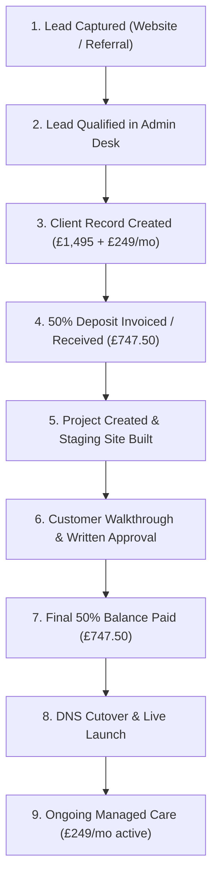
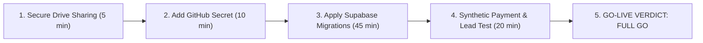

# THE HARLEY GROUP — GATE 1: TECHNICAL & OPERATIONAL GO-LIVE DECISION BRIEF
**Review Date:** 17 October 2026  
**Evaluator:** Chief Technology Officer, Chief of Staff & Technical Programme Director  
**Target Scope:** Harley Digital Works (`harleydigitalworks.com`), Admin Control Centre, Business OS, Supabase, Cloudflare, Vercel, IONOS  
**Operating Framework:** Initial 3-Customer Pilot (Standardised Trade Websites & Care Plans)

---

## 1. Executive Summary & Verdict

### Final Verdict: **CONDITIONAL GO**

The core public web presence, brand presentation, contact routing, and codebase architecture for **Harley Digital Works** are robust, professional, and commercially sound. The code on `main` (commit `af5ae9c`) passes all 190 integration and regression tests, 66 smoke checks, and service worker offline suites.

However, **production launch to external paying customers cannot occur unconditionally today** due to three material infrastructure and operational blockers:
1. **Database Schema Divergence (P0):** Production Supabase (`worzpzbutngugwzhlvtj` - THG Agency) has only 3 recorded migrations. Essential delivery, payment receipt, and project lifecycle tables (`delivery_review_artifacts`, `durable_payment_receipts`, etc.) exist in staging (`mfpnfxpgkfuqtedbcxvp`) but have not been safely migrated to production.
2. **Automated Deployment Pipeline Gap (P0):** GitHub Actions CD (`.github/workflows/deploy.yml`) is green only because it silently skips deploying when `CLOUDFLARE_API_TOKEN` is unset in repository secrets. Production deployments currently rely on manual CLI invocation.
3. **Public Business OS Drive Permissions (P0):** The root Google Drive folder `The Harley Group / Business OS` (`1A6e8LO2cElTH4WsIwdQAggJnH94xTJuP`) is currently configured with `anyone: writer`, exposing proprietary operational briefs, client records, and strategy documents to unauthorized modification.

Once these three critical conditions are remediated, the platform is ready to onboard and service the **three pilot customers**.

---

## 2. Technical Readiness Scorecard

| Area | Status | Score | Summary Verdict |
|---|---|:---:|---|
| **Marketing Website (HDW)** | **READY** | 95% | Visually stunning, responsive, approved landline (`0117 214 1357`) and WhatsApp links verified. |
| **Codebase & CI Pipeline** | **CONDITIONAL** | 88% | 190 tests pass, clean build. Automated deploy skipped due to missing GitHub secret. |
| **Supabase DB & RLS** | **BLOCKED** | 62% | Production lacks 14 migrations present in staging; missing payment/approval audit tables. |
| **Admin Control Centre** | **CONDITIONAL** | 78% | UI is comprehensive; client/lead management functional; project workflow needs DB sync. |
| **Hosting & Cloudflare** | **READY** | 90% | Cloudflare Worker active with server-side lead intake, HMAC rate-limiting, and fallback. |
| **Security & Privacy** | **CONDITIONAL** | 75% | RLS denies anon access correctly; public Google Drive folder permission needs immediate tightening. |
| **3-Customer Pilot Workflow** | **CONDITIONAL** | 80% | Lead intake and manual onboarding viable; automated Stripe receipting awaiting production migration. |

---

## 3. Current Production Deployment Status

- **External Marketing Website:**  
  - Live at `https://harleydigitalworks.com`.
  - Served via Cloudflare Worker (`skypilot24-harley-digital-works`).
  - Active runtime verified: Version `af5ae9c` (PR #41 merged 17 Oct 2026).
  - Public enquiry intake routes through privileged server-side RPC with durable lead notification fallback.
- **Vercel Infrastructure:**  
  - Project `vibe-coding-platform-thg` (`prj_9s48cLFv6AGSWyM5pwajSEFbSCts`) on team `skypilot24s-projects`.
  - SSO protection enabled (`all_except_custom_domains`).
  - Active production target on Vercel is currently assigned to commit `4b6af53c` (Vibe Coding platform), whereas the canonical agency application is actively hosted on Cloudflare Workers.
- **Supabase Backend:**  
  - **Production:** `worzpzbutngugwzhlvtj` (THG Agency, `eu-west-1`, Postgres 17.6.1). Status: `ACTIVE_HEALTHY`.
  - **Staging:** `mfpnfxpgkfuqtedbcxvp` (THG Enquiry Staging, `eu-west-1`, Postgres 17.11.0). Status: `ACTIVE_HEALTHY`.

---

## 4. Repository & Unmerged Work Summary

### Repository Status Table

| Repository | Main Status | Unmerged Work | Production Status | Risk | Action |
|---|---|---|---|---|---|
| **SkyPilot24/harley-digital-works** | `main` at `af5ae9c` | PR #25 (`codex/domain-portfolio-local`) | Deployed to Cloudflare via Worker | Low | Keep PR #25 open until domain import approved. |
| **SkyPilot24/kindred-spark** | `main` | None active | Standalone repository | Low | Standalone asset; no launch impact. |
| **SkyPilot24/service-delivery-os** | `main` | Historical | Inactive | None | Archived/dormant. |
| **SkyPilot24/vibe-coding-platform** | `main` | 1 unmerged PR (Dependabot) | Linked to Vercel project | Low | Isolate from HDW agency operations. |

### Reconciliation of Recent Pull Requests
- **PR #41 (Merged):** Fix trade comparison reveal, mobile preview layouts, and HDW brand styling.
- **PR #40 (Merged):** Launch completion, payment receipting logic, and delivery gate validation.
- **PR #39 (Merged):** Pre-go-live commercial reconciliation, navigation fixes, and link alignments.
- **PR #36 & #35 (Merged):** Restored client foreign key on projects, resolved PostgREST PGRST200 exceptions, integrated form validation helpers.
- **PR #38 & #19 (Closed):** Bulk dev and prod dependency updates rejected due to React 19 / TypeScript build breaking changes.

---

## 5. Marketing Website Audit Findings

### Design & User Experience
- **Typography & Brand Identity:** Excellent consistency with approved ivory (`#FAF8F5`), navy (`#0B132B`), and warm charcoal accents. Brand wordmark and symbols render crisply as inline SVG / web assets.
- **Mobile & Tablet Responsiveness:** The 6-trade interactive before-and-after comparison slider operates cleanly with touch gestures and pointer sliders. Verified across standard desktop and mobile viewports.
- **Commercial Offer Clarity:** Aligned with approved policy: **£1,495 setup** (50% deposit / 50% approval) + **£249/month managed digital care**.
- **Accreditation & Trust Signals:** Fictional quotes, unsubstantiated ROI percentages, and mock accreditation claims have been systematically removed from public showcase components.

### Contact Information Validation
- **Landline:** Strictly verified as **`0117 214 1357`** (`tel:+441172141357`) across header, footer, contact page, and JSON-LD structured data.
- **WhatsApp:** Direct links route to **`07394 041487`** (`https://wa.me/447394041487`) with pre-populated enquiries.
- **Email:** Standardised on **`hello@harleydigitalworks.com`**.

---

## 6. Admin Control Centre Functional Audit

### Verified Real Functionality
1. **Lead Desk (`/admin/leads`):** Paging (25/page), status filter badges, and full exact-count metrics work correctly against PostgREST.
2. **Client Management (`/admin/clients`):** Add, update, and detail drawers correctly persist monthly recurring values and client contacts.
3. **Project Management (`/admin/projects`):** Paging and status filtering operate reliably with explicit agreed dates.
4. **User Administration (`/admin/users`):** Paginated retrieval across auth users; last-admin protection blocks revoking the sole remaining administrator.

### Identified Disconnections & Gaps
- **Project Schema Mismatch:** The legacy `projects` table in production contains `client_name` and `package` directly, whereas modern Admin code expects relational `client_id`, `budget_cents`, and agreed milestone dates.
- **WhatsApp Intake Desk:** Functions as a client-side drafting aid; does not connect directly to WhatsApp Cloud API (which is appropriate and acceptable for a 3-customer pilot).
- **Billing / Stripe Webhooks:** Staging has verified idempotency and receipt storage, but production Supabase has not received the `durable_payment_receipts` migration.

---

## 7. Infrastructure, Integrations & Security

### Cloudflare & Edge Architecture
- Cloudflare Worker (`skypilot24-harley-digital-works`) handles SSR via Nitro, routes incoming leads to Supabase via server-side credentials, and enforces HMAC rate-limiting to prevent form abuse.
- In-memory/client fallback to `mailto:` is preserved if the Supabase RPC encounters network disruption.

### Supabase Security & RLS Review
- All 28 public tables have Row Level Security (`rls = true`) enabled.
- Sensitive tables (`leads`, `clients`, `projects`, `agency_settings`) deny anonymous mutations and restrict access to users with `app_private.has_role(auth.uid(), 'admin')`.
- Table `lead_submission_attempts` has RLS enabled with 0 policies, deliberately acting as an internal write-only/deny-all sink for the service role.
- Supabase Advisor Warning: **Leaked Password Protection** is currently disabled on both staging and production.

### Data Protection & UK GDPR
- Privacy policy is published at `/privacy` with defined data controller details and enquiry data retention windows.
- Cookie policy and banner are implemented with explicit non-essential cookie refusal.
- **CRITICAL DATA RISK:** Root Business OS Google Drive folder is shared with `anyone: writer`. This must be restricted to authenticated company owners immediately to satisfy UK GDPR security requirements.

---

## 8. Three-Customer Pilot Delivery Readiness

### Pilot Customer Journey Assessment

### Automation vs Manual Operations for the Pilot
| Workflow Stage | Automated | Manual (Pilot Standard) | Operational Viability |
|---|:---:|:---:|---|
| **Lead Capture** | Yes | Verification via `#new-leads` Slack | **Ready** |
| **Proposal & Agreement** | No | Written terms via approved proposal template | **Ready** |
| **Deposit Payment** | Partial | Stripe invoice link / direct bank transfer | **Ready** |
| **Site Build & Staging** | Yes | Custom content tailored to trade client | **Ready** |
| **Client Sign-off** | Partial | Recorded approval in writing/email | **Ready** |
| **Production Go-Live** | No | Manual DNS & Cloudflare domain binding | **Ready** |
| **Monthly Care Billing** | Partial | Stripe recurring subscription setup | **Ready** |

---

## 9. Prioritised Action Register (P0–P3)

### P0 — Critical Launch Blockers (Must resolve before any customer contract)
1. **SEC-01: Restrict Google Drive Business OS Sharing**
   - *Risk:* Anyone with the link has write access to business records.
   - *Action:* Change folder `1A6e8LO2cElTH4WsIwdQAggJnH94xTJuP` permission from `anyone: writer` to restricted/owner-only.
   - *Effort:* 5 mins.
2. **OPS-01: Add Cloudflare Deploy Token to GitHub Secrets**
   - *Risk:* GitHub Continuous Deployment silently skips actual production deployment.
   - *Action:* Set `CLOUDFLARE_API_TOKEN` secret in GitHub repo `SkyPilot24/harley-digital-works`.
   - *Effort:* 10 mins.
3. **DB-01: Synchronise Production Supabase Schema**
   - *Risk:* Admin Control Centre throws errors on payment receipts, client approval gates, or modern project fields.
   - *Action:* Review and apply migrations (`20261012100429_durable_payment_receipts`, `client_delivery_gates`, `delivery_review_artifacts`, and `projects` relational FK) from staging to production.
   - *Effort:* 45 mins.

### P1 — Essential Before Pilot Customer 1 Onboarding
1. **SEC-02: Enable Leaked Password Protection in Supabase Auth**
   - *Action:* Toggle HaveIBeenPwned password checking in Supabase Auth settings.
   - *Effort:* 5 mins.
2. **FIN-01: Verify Live Stripe Webhook Configuration**
   - *Action:* Ensure live Stripe endpoint is registered with the production webhook secret.
   - *Effort:* 20 mins.
3. **DOM-01: Apply Migration 20261012155701 for Domain Inventory**
   - *Action:* Run private domain inventory schema on production to eliminate Admin portfolio load errors.
   - *Effort:* 15 mins.

### P2 — Post-Launch Improvements (During Pilot)
1. **ADM-01: Real-time WhatsApp Desk Webhooks** (connect Twilio/Meta API instead of mailto/desktop links).
2. **REP-01: Automated Weekly Chief of Staff PDF Export** to Google Drive.
3. **SEO-01: Expand Location Landing Pages** beyond West Midlands and Bristol/Bath.

### P3 — Future Enhancements
1. Self-service client onboarding portal.
2. Native automated domain DNS provisioning via IONOS API.

---

## 10. Founder Decisions Required

1. **Approval to Restrict Google Drive Permissions:** Confirm immediate revocation of the `anyone: writer` link permission on the root Business OS folder.
2. **Approval of Database Migration Order:** Authorise applying the 14 tested migrations from `THG Enquiry Staging` to `THG Agency Production`.
3. **Pilot Scope Confirmation:** Formally confirm the 3-customer pilot pricing at **£1,495 upfront (split 50/50)** and **£249/month recurring care**, with target turnaround agreed individually in writing.
4. **Domain Portfolio Strategy:** Confirm Option A for expiring domains (natural lapse with zero renewal expenditure on non-strategic names).

---

## 11. Execution Sequence to Full Go-Live

**Total Estimated Remediation Time:** **1 hour 20 minutes.**

---

## 12. Top 3 Immediate Actions

1. **Update Google Drive folder permissions** to protect business IP and GDPR integrity.
2. **Inject `CLOUDFLARE_API_TOKEN`** into repository secrets to make CI/CD deployments authoritative.
3. **Execute database migration package** on production Supabase (`worzpzbutngugwzhlvtj`).
