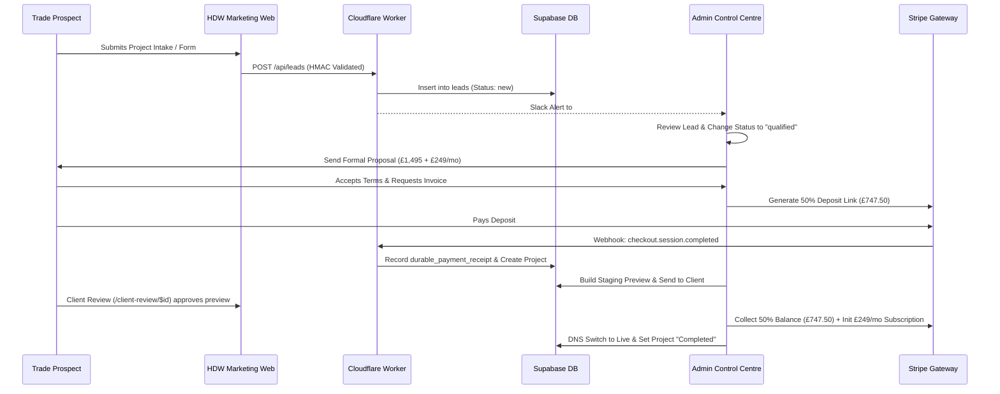
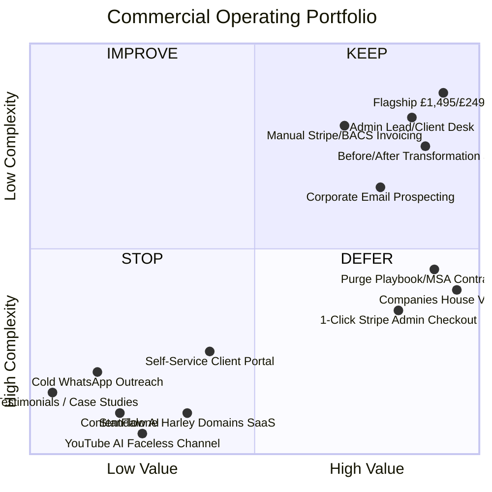
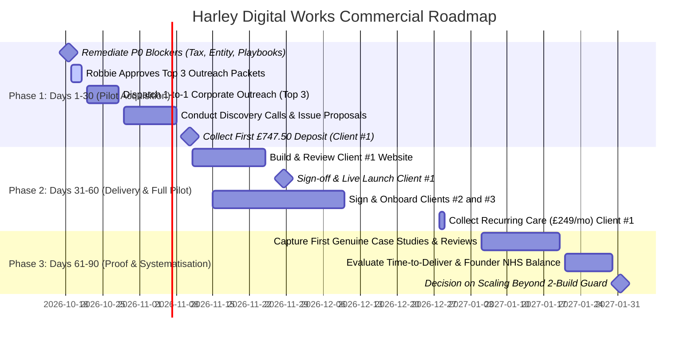

# THE HARLEY GROUP — GATE 2: COMMERCIAL, SALES & REVENUE GO-LIVE ASSESSMENT

**Review Date:** 17 October 2026  
**Evaluator:** Chief Commercial Officer, Chief of Staff, Pricing Strategist & Head of Revenue Operations  
**Target Brand:** Harley Digital Works (Trading under The Harley Group)  
**Operating Scope:** 3-Customer Commercial Pilot (Standardised Trade Websites & Ongoing Digital Care)  
**Target Geography & Niche:** Bristol, Bath & M4 Corridor — Established Electrical Contractors (2–8 staff)

---

## 1. Executive Summary & Commercial Verdict

### Final Commercial Verdict: **CONDITIONAL GO**

Harley Digital Works has established an exceptional, highly differentiated technical foundation and brand aesthetic. The flagship commercial architecture — **£1,495 upfront setup (50% deposit / 50% sign-off) + £249/month ongoing managed care** on a rolling 30-day agreement — is fundamentally sound, highly profitable, and properly tailored to the founder's capacity constraints (10–12 hours/week alongside an NHS career).

However, **live commercial outreach, contracting, and customer payment collection cannot proceed unconditionally today** due to four material commercial, legal, and operational discrepancies:

1. **Tax Presentation & Marketing Collateral Inconsistencies (P0):** While the public marketing site (`WebsitePackagesSection.tsx`) correctly removed unsupported VAT and delivery claims, internal sales playbooks (`01-trade-outbound-email-and-letter-campaign.md`), onboarding pages (`/onboarding`), and print contract templates (`01-proposal-matrix.html`, `05-the-harley-group-master-services-agreement.html`) still quote illegal "+ VAT" terminology, obsolete £95/mo care rates, unratified £2,995 packages, and fictional case studies (e.g. "Apex Electrical increased quote requests by +140%").
2. **Seller Identity & Registration Unresolved (P0):** The owner confirmed trading as _Harley DigitalWorks Ltd_ and confirmed the entity is **not VAT-registered** (operating under the £90,000 statutory threshold). However, the supplied company number (`546743`) returned no record on Companies House. Official contracts and invoices cannot be legally issued without an authentic 8-digit company number or confirmed sole trader status.
3. **Billing Execution Bridge (P0):** The Stripe sandbox webhook infrastructure is technically validated, but the Admin Control Centre (`/admin/invoices`) only outputs raw internal draft text. There is no automated bridge to generate live Stripe Checkout links or hosted invoices. A standardised manual billing protocol (Stripe Dashboard payment link or direct BACS invoice) must be formally designated for the pilot.
4. **Outreach Compliance Guardrails (P0):** Sales playbooks advocate cold, unsolicited WhatsApp direct messaging. Under UK PECR (Regulation 22) and Meta WhatsApp Business Terms of Service, unsolicited marketing via SMS/WhatsApp to individual mobile numbers without prior opt-in consent is unlawful. Cold outreach must be strictly restricted to corporate B2B email (UK Limited Companies) and direct postal mail.

Once these four immediate blockers are reconciled, the business is in an exceptional position to initiate outreach and onboard its **first three paying customers**.

---

## 2. Commercial Readiness Scorecard

| Area                                       | Status          | Score | Summary Assessment                                                                                               |
| ------------------------------------------ | --------------- | :---: | ---------------------------------------------------------------------------------------------------------------- |
| **Pricing & Package Structure**            | **CONDITIONAL** |  85%  | Core £1,495 / £249 model is ratified and defensive; collateral contains conflicting legacy rates (£95/mo, +VAT). |
| **Market Positioning & Value Proposition** | **READY**       |  92%  | "Zero homework / complete digital enquiry desk" message resonates powerfully with busy trades.                   |
| **Unit Economics & Margins**               | **READY**       |  96%  | 48.3% upfront contribution net of labour; 73.1% recurring margin; Day 0 CAC payback. Cashflow defensive.         |
| **Outreach System & Compliance**           | **CONDITIONAL** |  70%  | High-quality prospect vetting code and 3 verified prospects; cold WhatsApp scripts must be eliminated.           |
| **CRM & Lead Management**                  | **READY**       |  88%  | Admin Desk handles paging, filtering, status changes, and counts. Fully fit for the 3-customer pilot.            |
| **Sales Journey & Conversion**             | **READY**       |  90%  | Interactive before/after comparisons and frictionless review funnels are live and compelling.                    |
| **Billing, Invoicing & Payments**          | **CONDITIONAL** |  72%  | Sandbox webhooks verified; Admin lacks 1-click live link creation; manual invoice protocol required.             |
| **Capacity & Delivery Safeguards**         | **READY**       |  95%  | Strict 2-build concurrency cap enforced in code to protect founder NHS schedule balance.                         |

---

## 3. Current Commercial Position Audit

### 3.1 Historical Evolution & Commercial Decisions

A comprehensive audit of repository history, Business OS archives, and Chief of Staff briefings reveals a progression from early exploratory agency ideas to a disciplined, productised service:

- **3 October 2026 (Founding Direction):** The Harley Group established as umbrella; Harley Digital Works as customer-facing trade agency; Harley Labs as experimental hub. Decision ratified: near end-to-end automation, exception-based management, and preservation of founder NHS work-life balance (10–12 hrs/week).
- **7 October 2026 (Commercial Blueprint Ratified):** Flagship offer ratified: £1,495 setup + £249/mo care. Hard limit of 2 concurrent builds.
- **11–13 October 2026 (Prospecting & Brand):** Rigorous qualification of Bristol & Bath electrical contractors; identification of top 3 candidates; brand refresh to navy/ivory.
- **14 October 2026 (First-Client Commercial Decisions):** Identification of 6 critical commercial gates (seller identity, tax status, sold routing, support SLAs, cancellation terms, and durable receipts). Owner confirmed _Harley DigitalWorks Ltd_, not VAT-registered, Keynsham address.
- **17 October 2026 (Gate 1 Technical Go-Live):** Conditional technical clearance granted; interactive before/after portfolio deployed; public copy purged of unverified claims.

### 3.2 Authority & Reconciliation Matrix

| Commercial Element   | Approved Direction                                | Implemented Reality                                 | Planned / Deferred            |         Status         |
| -------------------- | ------------------------------------------------- | --------------------------------------------------- | ----------------------------- | :--------------------: |
| **Target Niche**     | Established UK Electrical Contractors (2–8 staff) | Focus on Bristol, Bath, and M4 corridor             | Heating/plumbing expansion    | **Approved & Active**  |
| **Flagship Pricing** | £1,495 setup (50/50 split) + £249/mo care         | Live on `/` and `/services/web-design-development`  | £995 entry / £2,495 expansion |  **Approved & Live**   |
| **VAT & Tax**        | Not VAT-registered (statutory exemption <£90k)    | Removed from main public copy; present in playbooks | Accounting reconciliation     |  **Action Required**   |
| **Legal Entity**     | Harley DigitalWorks Ltd                           | Owner confirmed; Co No 546743 unverified            | Companies House verification  |  **Action Required**   |
| **Enquiry Routing**  | Dual-channel: Supabase DB + Slack/Email alert     | Server-side Cloudflare Worker + Slack webhook       | SMS/Twilio customer alerts    | **Implemented & Live** |
| **Capacity Guard**   | Max 2 active onboarding builds                    | Hardcoded in `outreach-dispatcher.ts`               | Scaled build queue            | **Implemented & Live** |
| **Outreach System**  | Corporate B2B email & direct mail                 | Prospect schema and 3 top prospects vetted          | WhatsApp batch campaigns      |  **Compliance Hold**   |
| **Invoicing Engine** | Stripe automated receipts & customer portal       | Sandbox tested; Admin outputs draft text            | 1-click Stripe billing        |  **Manual for Pilot**  |

---

## 4. Comprehensive Pricing & Package Assessment

### 4.1 Audit of Existing Packages

Three distinct packages are defined in governing records (`COMMERCIAL_OFFER_MANAGED.md`):

1. **The Launchpad (Entry Tier):**
   - _Price:_ £995 setup (50/50: £497.50 deposit / £497.50 balance) + £149/month care.
   - _Scope:_ 3-page site, done-for-you copy, Google Business Profile alignment, Cloudflare hosting, 15-min monthly edits.
   - _Target:_ Solo subcontractors and micro-partnerships (1–2 staff).
2. **The Revenue Engine (Core Flagship — Pilot Standard):**
   - _Price:_ £1,495 setup (50/50: £747.50 deposit / £747.50 balance) + £249/month care.
   - _Scope:_ 5-page trade site (Home, About, Services, Selected Work, Dual Enquiry Desk), 100% DFY trade copywriting, verified accreditation badges, local Schema JSON-LD, dual lead desk (DB + instant email/Slack alerts), 2 preview revision rounds, 30-min monthly edit batch, 24h SLA.
   - _Target:_ Established contractors (2–8 staff, £300k–£1m turnover).
3. **The Market Leader (Expansion Tier):**
   - _Price:_ £2,495 setup (50/50: £1,247.50 / £1,247.50) + £399/month care.
   - _Scope:_ 8-page site, 3 geo-targeted area pages, missed-call auto-reply, review booster kit, Google LSA setup, 60-min monthly edits.
   - _Target:_ Regional trade firms with multi-van fleets (5–15 staff).

### 4.2 UK Trade Market Benchmarking

| Competitor Model                                    |    Setup Fee    |  Ongoing Fee   |          Contract Term          | Key Inclusions & Support                                                            | Positioning & Friction                                                 |
| --------------------------------------------------- | :-------------: | :------------: | :-----------------------------: | ----------------------------------------------------------------------------------- | ---------------------------------------------------------------------- |
| **Pay-Monthly WaaS (Tradefy / WebHeay)**            |    £0 – £99     |  £49 – £99/mo  | 12-month lock-in; rolling after | Basic template, hosting, SSL, minor updates. Agency owns code.                      | High volume, low touch. High churn if leads don't appear.              |
| **Trade Builders (Expert Trades / Toolstation)**    |    £0 – £150    |  £29 – £69/mo  |    Rolling / Annual discount    | Self-service builder, review showcase, basic directory listing.                     | Tradesperson must write own copy and upload photos ("homework").       |
| **Standard UK Agency (Local WordPress Studios)**    |  £750 – £1,850  |  £30 – £80/mo  |  Build contract; rolling care   | 5–10 pages, bespoke build, basic local SEO, client owns assets.                     | High upfront friction; care plans lack proactive lead support.         |
| **High-End Trade Lead-Gen (Tradie / Trade Growth)** | £1,500 – £3,500 | £199 – £499/mo |      3 to 6-month minimum       | Bespoke copy, funnel design, active local SEO, call tracking.                       | Aimed at large firms (£1m+ turnover); includes ad spend fees.          |
| **Harley Digital Works (Ratified Flagship)**        |   **£1,495**    |  **£249/mo**   | **Rolling 30-day (No lock-in)** | **5-page authority site, 100% DFY copy, Schema SEO, dual lead desk, 30-min edits.** | **Premium productised service. "Zero homework" and enterprise speed.** |

### 4.3 Pricing Evaluation & Commercial Recommendations

- **Is £1,495 too high or too low?** For an established electrical contractor with 3–5 vans generating £500k/year, £1,495 is a modest capital expenditure (equivalent to one small consumer unit replacement or EV charger installation). It establishes immediate commercial credibility. Offering it cheaper would signal amateur freelancer quality.
- **Is £249/month defensible on a rolling contract?** £249/mo is in the top decile for UK trade website hosting. To prevent early churn (after month 2 or 3), the value proposition cannot simply be "hosting and backups". It must be explicitly delivered as a **Managed Digital Presence & Enquiry Desk**, which includes monthly form health audits, Google Business Profile review guidance, and proactive monthly content refreshes.
- **Contradiction Removal:** All legacy mentions of "£95/mo care", "£2,995 growth", and "+ VAT" in print templates and sales playbooks must be purged prior to customer engagement.

---

## 5. Profitability & Unit Economics Analysis

### 5.1 Unit Economics Model (Base Case vs Sensitivity)

The financial model below evaluates actual variable delivery costs, software licences, payment processing, and founder labour valued at an internal commercial rate of **£40.00/hour**:

| Financial Metric                    | Conservative (Challenged) | Base Case (Expected)  | Optimistic (Favourable) | Basis & Assumptions                                                         |
| ----------------------------------- | :-----------------------: | :-------------------: | :---------------------: | --------------------------------------------------------------------------- |
| **Upfront Setup Revenue**           |       **£1,495.00**       |     **£1,495.00**     |      **£1,495.00**      | Ratified flagship setup fee.                                                |
| **Founder Delivery Labour**         |    22.0 hrs (£880.00)     |  14.0 hrs (£560.00)   |    8.0 hrs (£320.00)    | Base: Copy (3h), Build/Tailor (6h), Client Revisions (3h), DNS/Launch (2h). |
| **Preview / Sunk CAC Overhead**     |          £220.00          |        £150.00        |         £85.00          | Base assumes 1:4 conversion (3 unclosed mockups @ 1h ea + API usage).       |
| **AI Copy & Image Generation**      |          £45.00           |        £25.00         |         £10.00          | Claude / Gemini token costs for copy drafting and asset resizing.           |
| **Stock Imagery & Font Licences**   |          £35.00           |        £15.00         |          £0.00          | Trade-specific photography licenses.                                        |
| **Stripe UK Payment Fees**          |          £22.63           |        £22.63         |         £22.63          | 1.5% + £0.20 on £1,495.00.                                                  |
| **Total Upfront Delivery Cost**     |       **£1,202.63**       |      **£772.63**      |       **£437.63**       | Fully loaded upfront cost.                                                  |
| **Net Upfront Contribution (£)**    |       **+£292.37**        |     **+£722.37**      |     **+£1,057.37**      | **Cash positive prior to subscription start.**                              |
| **Upfront Contribution Margin (%)** |         **19.6%**         |       **48.3%**       |        **70.7%**        | Net margin after full founder labour allocation.                            |
| **Cash Margin (Excl. Labour)**      |   **£1,172.37 (78.4%)**   | **£1,282.37 (85.8%)** |  **£1,377.37 (92.1%)**  | Actual pre-tax cash generated into business account.                        |

### 5.2 Monthly Recurring Economics (£249/mo Care Plan)

| Monthly Operating Metric             |   Conservative   |    Base Case    |    Optimistic    | Basis & Assumptions                                  |
| ------------------------------------ | :--------------: | :-------------: | :--------------: | ---------------------------------------------------- |
| **Monthly Subscription Revenue**     |   **£249.00**    |   **£249.00**   |   **£249.00**    | Auto-debited monthly via Stripe.                     |
| **Cloudflare & Supabase Allocation** |      £12.00      |      £8.00      |      £5.00       | Prorated database storage and edge compute.          |
| **Support & Maintenance Labour**     | 2.0 hrs (£80.00) | 1.0 hr (£40.00) | 0.5 hrs (£20.00) | Base: 30-min edit allowance + enquiry health checks. |
| **Stripe Recurring Billing Fee**     |      £3.94       |      £3.94      |      £3.94       | 1.5% + £0.20 on £249.00.                             |
| **Tooling & Incident Buffer**        |      £25.00      |     £15.00      |      £5.00       | Slack webhook monitoring and uptime checks.          |
| **Total Monthly Operating Cost**     |   **£120.94**    |   **£66.94**    |    **£33.94**    | Fully loaded recurring cost.                         |
| **Monthly Net Contribution (£)**     |   **+£128.06**   |  **+£182.06**   |   **+£215.06**   | Net profit per active account per month.             |
| **Monthly Net Margin (%)**           |    **51.4%**     |    **73.1%**    |    **86.4%**     | Highly defensive recurring revenue margin.           |

### 5.3 Lifetime Value (LTV) & Payback Analysis

- **Payback Period:** **0 Months (Instant / Day 0).** Because the setup fee covers all build labour, transaction fees, and sunk preview costs, customer acquisition is fully amortised before the first monthly care payment.
- **Customer Lifetime Value (Base Case):**
  - **3-Month Account (Early Drop-off):** Revenue = £2,242.00 | Net Profit = **£1,268.55**
  - **6-Month Account (Standard):** Revenue = £2,989.00 | Net Profit = **£1,814.73**
  - **12-Month Account (Good Retention):** Revenue = £4,483.00 | Net Profit = **£2,907.09**
  - **24-Month Account (Sticky Core Client):** Revenue = £7,471.00 | Net Profit = **£5,091.81**
- **Three-Customer Pilot Portfolio Value (Year 1):**
  - 3 Clients × (£1,495 setup + 12 × £249/mo care) = **£13,449.00 Annual Revenue**.
  - Net Contribution Profit (Year 1) = **£8,721.27**.

---

## 6. Automated Outreach & Prospecting Engine Audit

### 6.1 Technical Architecture Verification

The codebase contains a modular outbound dispatch pipeline in `src/lib/outreach-dispatcher.ts`:

- **Data Integrity & Schema Enforcement:** Strictly typed with Zod (`qualifiedProspectSchema`). Rejects records lacking an 8-digit Companies House number, verified accreditation evidence, or factual observation summaries.
- **Capacity Interlock:** Before dispatching, `processOutreachBatch` checks `activeBuildsCount >= maxConcurrentBuilds` (set to 2). If the pilot queue is full, outreach halts automatically.
- **Explicit Human Approval Gate:** Every prospect record requires `approvedForSending: true`.
- **Deduplication:** Maintains an `alreadyContactedIds` Set to guarantee no prospect is messaged twice.
- **Audit Logging:** Emits durable audit records and posts real-time Slack notifications upon successful dispatch.

### 6.2 Outreach Compliance & Legal Audit (UK GDPR & PECR)

- **Corporate Email (Compliant):** Under UK PECR Regulation 22, marketing emails sent to corporate bodies (e.g. UK Limited Companies, LLPs) do not require prior opt-in consent. However, they must:
  1. Clearly identify the sender (Harley Digital Works / Dr Robbie Harley).
  2. Provide a valid business address.
  3. Include an immediate, frictionless opt-out / unsubscribe mechanism.
  4. Ensure processing of personal data (e.g. director names) complies with UK GDPR Article 6(1)(f) (Legitimate Interests).
- **Sole Traders & Partnerships (CRITICAL RISK):** Under PECR, sole traders and traditional partnerships are treated as _individual subscribers_. Sending cold electronic marketing without prior consent is illegal. Cold email or SMS to sole traders must be strictly avoided unless inbound opt-in is established.
- **WhatsApp & SMS Cold Messaging (CRITICAL RISK):** Playbook 04 proposes cold WhatsApp outreach. Sending unsolicited marketing via WhatsApp/SMS to mobile numbers without prior consent violates PECR and Meta Business Terms. **Recommendation: Stop and purge all automated cold WhatsApp outreach.**

### 6.3 Audit of Researched Pilot Prospects

Three top-tier corporate prospects have been identified, verified on Companies House, and documented in `docs/PROSPECT_QUALIFICATION_PILOT_2026-10-13.md`:

- **Rank #1: RG Electrical Bristol Limited (Bradley Stoke, Bristol)**
  - _Company Number:_ 10082511 (Active UK Ltd Co)
  - _Accreditation:_ NICEIC / TrustMark confirmed
  - _Digital Defect:_ Homepage projects section features a "Projects coming soon" holding placeholder.
  - _Angle:_ Offer a private, mobile-responsive mockup displaying structured recent case studies to build instant domestic rewire credibility.
- **Rank #2: Bath-Electrical Ltd (Bath, Somerset)**
  - _Company Number:_ 07702599 (Active UK Ltd Co)
  - _Accreditation:_ NICEIC claimed
  - _Digital Defect:_ Workmanship copy explicitly references outdated "17th Edition" wiring regulations (BS 7671 has been on the 18th Edition for several years).
  - _Angle:_ A supportive, respectful copy check to modernise their standards presentation.
- **Rank #3: Nextgen Electrical Contractors Ltd (Warmley, Bristol/Bath)**
  - _Company Number:_ 11042444 (Active UK Ltd Co)
  - _Accreditation:_ NICEIC Approved Contractor
  - _Digital Defect:_ Template placeholder email address displayed alongside business contact details.
  - _Angle:_ Fixing contact desk friction to capture high-value commercial and EV charging enquiries.

---

## 7. Recommended Three-Customer Acquisition Strategy

To acquire the three pilot customers efficiently without cold calling or unlawful messaging, deploy a **High-Touch, Low-Volume Founder Outreach Protocol**:

### 7.1 Target Segment Definition

- **Trade:** Established Electrical Contractors (NICEIC or NAPIT registered).
- **Size:** 2–8 staff, operating 2+ vans, £300k–£1m turnover.
- **Location:** Bristol, Bath, and the M4 Corridor (allowing founder local context).
- **Digital State:** Poor mobile experience, missing reviews, or incomplete project galleries.

### 7.2 Outreach Protocol: The 3-Touch Calibrated Email Sequence

#### Touch 1: The Constructive Observation (Day 1)

- _Channel:_ 1-to-1 personalised email from `robbie@theharleygroup.org`.
- _Tone:_ Factual, professional, supportive, and local.
- _Focus:_ Highlight one specific observable defect (e.g. portfolio placeholder, outdated wiring regs text) and offer a private, no-obligation preview mockup. Zero sales pressure.

#### Touch 2: The Staged Preview Link (Day 4)

- _Content:_ Send a private 60-second video walkthrough or private preview link (`demos.electrician-concept`) showing how their business looks with modern branding, accreditation badges, and tap-to-call mobile buttons.

#### Touch 3: The 1-Page Summary & Respectful Sign-Off (Day 8)

- _Content:_ Attach the 1-page proposal summary (£1,495 setup + £249/mo care, 50/50 milestone terms) and provide a direct link to book a 10-minute discovery call or reply via WhatsApp.

### 7.3 Pilot Conversion Funnel & Targets

| Funnel Stage                             |  Conservative  |   Base Case    |   Optimistic   |
| ---------------------------------------- | :------------: | :------------: | :------------: |
| **Target Prospects Researched & Vetted** |       30       |       20       |       12       |
| **Personalised Outreach Sent**           |       25       |       18       |       10       |
| **Positive Responses / Enquiries**       |    4 (16%)     |    5 (28%)     |    5 (50%)     |
| **Discovery Calls / Walkthroughs**       |       3        |       4        |       4        |
| **Proposals Issued**                     |       3        |       3        |       3        |
| **Paying Customers Signed (Target)**     |     **3**      |     **3**      |     **3**      |
| **Time to Acquire 3 Customers**          | **45–60 Days** | **30–45 Days** | **14–21 Days** |

---

## 8. CRM Functional & Commercial Review

### 8.1 CRM Capabilities Audit (Admin Control Centre)

The Admin Control Centre (`/admin/leads`, `/admin/clients`, `/admin/projects`) was audited against the complete commercial lifecycle:

1. **Lead Desk (`/admin/leads`):**
   - _Status:_ **READY.**
   - _Features:_ 25-row server-side paging, status filtering (`new`, `contacted`, `qualified`, `won`, `lost`), exact count badges, and literal string search across name, company, and email.
   - _Data Flow:_ Contact form submissions on `harleydigitalworks.com` automatically create records in `leads` via Cloudflare Worker RPC, with instant Slack notifications to `#new-leads`.
2. **Client Management (`/admin/clients`):**
   - _Status:_ **READY.**
   - _Features:_ Client drawer persists company name, contact details, notes, and monthly recurring value (in exact integer pence).
3. **Project Tracking (`/admin/projects`):**
   - _Status:_ **READY (Conditional on DB Sync).**
   - _Features:_ Tracks build stage, client links, target dates, and approval states.
4. **Data Validation & Protection:**
   - _Status:_ **READY.**
   - _Features:_ `admin-validation.ts` and `admin-writes.ts` enforce strict schema checks, non-sensitive errors, and cache invalidation.

### 8.2 End-to-End Workflow Verification

### 8.3 CRM Decision

**Verdict: KEEP & REFINE.**  
The custom Admin Control Centre is fast, focused, and already integrated with the core database and Slack alerting. Replacing it with HubSpot, Pipedrive, or Salesforce would introduce unnecessary subscription costs (£50–£150/mo), complex OAuth sync hurdles, and context switching without adding any commercial value for a 3-customer pilot.

---

## 9. Billing, Payments & Revenue Operations

### 9.1 Revenue Operations Journey

### 9.2 Billing & Payment Readiness Assessment

- **Stripe Integration Status:** The server-side webhook handler (`src/lib/payment-receipts.server.ts`) is fully implemented with cryptographic signature verification, currency protection, dispute tracking, and idempotent receipt storage.
- **Identified Gap:** The Admin UI currently generates draft text rather than executing a live API call to create a Stripe Checkout Session or invoice link.
- **Pilot Standard Procedure:** For the three pilot customers, the founder should create the invoice directly in the **Stripe Dashboard**:
  - Issue **Invoice 1:** £747.50 (Milestone 1 Deposit — Non-refundable build reservation).
  - Issue **Invoice 2:** £747.50 (Milestone 2 Balance — Payable prior to DNS launch).
  - Issue **Subscription:** £249.00/month (Rolling 30-day Managed Care — Auto-debit via Stripe Billing starting on launch date).
- **Alternative:** Bank transfer (BACS) is completely acceptable for UK trades, who are accustomed to paying commercial invoices directly from their online business banking accounts.

---

## 10. Commercial Simplification: Keep, Improve, Simplify, Defer, Stop

### Categorised Action Summary

- **KEEP (Working & Valuable):**
  - Core flagship offer (£1,495 setup + £249/mo care).
  - Admin Control Centre Lead & Client desks.
  - Interactive before-and-after trade comparison slider.
  - Strict 2-build concurrency limit.
- **IMPROVE (Optimise Before Customer 1):**
  - Synchronise print materials (`01-proposal-matrix.html`, `05-msa.html`) with confirmed pricing and non-VAT status.
  - Reconcile seller company number and trading address on all invoices.
  - Clean up `/onboarding` page copy (remove old £95/mo and blanket 14-day turnaround claims).
- **SIMPLIFY (Remove Friction):**
  - Use direct Stripe Dashboard payment links or BACS bank transfers for pilot invoices instead of building custom Stripe invoicing engines.
  - Use founder-led 1-to-1 email outreach rather than complex multi-stage automation loops.
- **DEFER (Post-Pilot Scale):**
  - Automated IONOS DNS cutover API.
  - Interactive quote calculator (`/calculator`).
  - Standalone domain marketplace and SaaS tools (Domain OS, ContentFlow).
  - YouTube faceless media projects.
- **STOP (Low Value / High Risk):**
  - Unsolicited cold WhatsApp messaging campaigns.
  - Fictional customer case study citations in outbound playbooks.

---

## 11. Prioritised Commercial Action Register (P0–P3)

### P0 — Commercial Go-Live Blockers (Must resolve before contacting prospects)

1. **COM-01: Purge Conflicting Pricing & VAT Claims from Sales & Legal Docs**
   - _Impact:_ Quoting "+ VAT" when not VAT-registered is a regulatory violation; quoting £95/mo care causes severe pricing disputes.
   - _Action:_ Update `docs/sales-playbooks/01-trade-outbound-email-and-letter-campaign.md`, `docs/print-materials/01-harley-digital-works-proposal-matrix.html`, and `05-the-harley-group-master-services-agreement.html` to reflect £1,495 setup, £249/mo care, and "VAT not applicable". Remove fictional Apex Electrical case study.
   - _Effort:_ 45 mins.
2. **COM-02: Reconcile Seller Legal Entity & Company Number**
   - _Impact:_ Contracts and invoices lacking a verified legal entity or valid company registration number are legally defective.
   - _Action:_ Founder to confirm whether trading as _Harley DigitalWorks Ltd_ (and supply the valid 8-digit Companies House number) or trading as a Sole Trader (_Dr Robbie Harley t/a Harley Digital Works_).
   - _Effort:_ 15 mins (Founder input).
3. **COM-03: Eliminate Cold WhatsApp Outreach from Active Playbooks**
   - _Impact:_ Avoids UK PECR enforcement fines and Meta account bans.
   - _Action:_ Update Playbook 04 to designate WhatsApp exclusively as an _inbound customer service channel_ and restrict cold outreach to corporate email and direct mail.
   - _Effort:_ 20 mins.
4. **COM-04: Establish Standard Pilot Payment & Invoicing Protocol**
   - _Impact:_ Guarantees seamless, professional collection of the £747.50 deposit.
   - _Action:_ Configure two product items in the live Stripe Dashboard (£747.50 Setup Milestone and £249.00/mo Managed Care) and document bank transfer (BACS) instructions.
   - _Effort:_ 30 mins.

### P1 — Essential for Initial Pilot Acquisition

1. **SLS-01: Update `/onboarding` Route Copy**
   - _Action:_ Align `/onboarding` header badges: change "£95/mo Managed Care" to "£249/mo Managed Care" and replace "14-Day Guaranteed Launch" with "Agreed Delivery Schedule".
   - _Effort:_ 15 mins.
2. **SLS-02: Founder Review of Top 3 Electrical Prospect Drafts**
   - _Action:_ Robbie to review and approve the calibrated, non-salesy outreach drafts for RG Electrical, Bath-Electrical, and Nextgen Electrical.
   - _Effort:_ 20 mins.
3. **OPS-01: Finalise Gate 1 Technical Prerequisites**
   - _Action:_ Apply Supabase production migrations (payment receipts and relational project schemas) and inject `CLOUDFLARE_API_TOKEN` into GitHub Secrets.
   - _Effort:_ 55 mins.

### P2 — Early Post-Launch Improvements (During Pilot)

1. **REP-01: Pilot Customer Feedback & Review Workflow**
   - _Action:_ Implement structured 7-day post-launch check-in to secure first genuine client quote and Google review.
2. **ADM-01: 1-Click Stripe Checkout Link Generator in Admin Control Centre**
   - _Action:_ Add server action to `/admin/invoices` that calls Stripe API to return an instant payment URL.

### P3 — Scale-Stage Enhancements (Post-Pilot)

1. Self-service client intake and file upload portal.
2. Programmatic landing page generation for adjacent trade verticals (plumbing, roofing).

---

## 12. Founder Commercial Decision Register

| Decision Required             | Agreed Direction                              | Options Considered                                                                                                 | Recommended Choice                                     | Rationale                                                                                                 | Immediate Approval Needed? |
| ----------------------------- | --------------------------------------------- | ------------------------------------------------------------------------------------------------------------------ | ------------------------------------------------------ | --------------------------------------------------------------------------------------------------------- | :------------------------: |
| **1. Invoicing Legal Entity** | _Harley DigitalWorks Ltd_ confirmed by Robbie | A) Limited Co (_Harley DigitalWorks Ltd_) B) Sole Trader (_Dr Robbie Harley t/a HDW_)                           | **Option A (if 8-digit Co No verified) else Option B** | Invoices must legally display a valid company number or proprietor name.                                  |        **YES (P0)**        |
| **2. Cold Outreach Channel**  | Multi-channel proposed                        | A) Corporate Email + Direct Mail only B) Email + Cold WhatsApp                                                  | **Option A (Corporate Email + Mail)**                  | Cold WhatsApp violates PECR and risks Meta blacklisting. Email to Ltd cos is 100% compliant.              |        **YES (P0)**        |
| **3. Pilot Intro Incentive**  | Ratified £1,495 / £249                        | A) Hold firm at £1,495 / £249 B) Pilot credit: First month care free (£249 saving) C) Discount setup to £995 | **Option B (First Month Care Included)**               | Preserves the £1,495 price anchor while providing a compelling closing incentive for the first 3 clients. |        **YES (P0)**        |
| **4. Invoicing Execution**    | Custom Stripe billing engine planned          | A) Stripe Dashboard links / BACS manual B) Build full custom in-app Stripe billing                              | **Option A (Stripe Dashboard / BACS)**                 | Eliminates weeks of custom coding; trades prefer paying professional Stripe or bank invoices.             |        **YES (P0)**        |

---

## 13. Practical 30 / 60 / 90-Day Execution Roadmap

---

## 14. Explicit Answers to Final Commercial Questions

1. **Are we priced correctly?**  
   **Yes, for established contractors (£300k–£1m turnover).** At £1,495 setup + £249/month on a rolling agreement, HDW occupies the premium, done-for-you bracket. It will encounter resistance from sole traders, but our stated target is established contractors with 2–8 staff who value saving 20 hours of their own time.
2. **Is our business model profitable?**  
   **Highly profitable.** Each setup generates £722.37 net contribution (48.3% margin) after fully costing founder labour at £40/hr, and £1,282.37 (85.8%) cash margin excluding labour. Recurring care generates £182.06/month net profit per account (73.1% margin). Payback period is Day 0.
3. **Is our prospecting and automated outreach actually working?**  
   **The prospecting and qualification engine works brilliantly; automated dispatch is properly paused.** Three ideal candidates have been identified with surgical accuracy. Automated cold WhatsApp messaging must be eliminated in favour of 1-to-1 corporate email.
4. **Is the CRM fit for purpose?**  
   **Yes.** The custom Admin Control Centre handles lead capture, paging, status progression, and client records with zero licensing cost. It is completely adequate for acquiring and managing 3 pilot customers.
5. **Can we reliably follow leads through to payment?**  
   **Yes, via a hybrid operational process.** Lead intake is fully automated. Proposals and invoices should be issued via calibrated email and Stripe Dashboard payment links / BACS invoices. Full end-to-end custom Stripe UI billing can safely wait.
6. **What should we change before contacting customers?**  
   Purge outdated "+ VAT", £95/mo, and £2,995 claims from sales playbooks and contract templates; confirm the exact 8-digit company number or sole trader trading style; and discard cold WhatsApp scripts.
7. **What can safely wait until after the pilot?**  
   In-app automated Stripe invoice generation, automated IONOS DNS provisioning, `/calculator` ROI modules, and expansion into heating/plumbing.
8. **How do we acquire our first three paying customers as efficiently as possible?**  
   Have Robbie send the calibrated, non-aggressive, 1-to-1 personal emails directly to the directors of **RG Electrical Bristol Limited**, **Bath-Electrical Ltd**, and **Nextgen Electrical Contractors Ltd**, offering a private, no-obligation preview showing how their specific digital defects can be resolved.

---

## 15. Top Three Immediate Actions

1. **Execute P0 Document Cleanup:** Update `docs/sales-playbooks/01-trade-outbound-email-and-letter-campaign.md`, `01-harley-digital-works-proposal-matrix.html`, and `05-the-harley-group-master-services-agreement.html` to eliminate "+ VAT", £95/mo, and fictional testimonials.
2. **Verify Seller Company Registration:** Founder to confirm the 8-digit Companies House number for _Harley DigitalWorks Ltd_ (or approve trading as _Dr Robbie Harley t/a Harley Digital Works_).
3. **Authorise & Send Outreach to Prospect #1:** Founder to authorise sending the factual, supportive email draft to **RG Electrical Bristol Limited** regarding their "Projects coming soon" portfolio placeholder.
