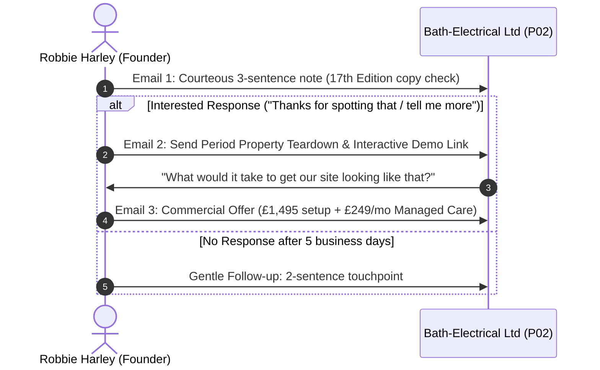

# Pilot Audit Teardown & Mockup Specification: Bath-Electrical Ltd (P02)
**Prepared:** 13 October 2026 | **Governing Framework:** `docs/COMMERCIAL_OFFER_MANAGED.md` & `BUSINESS_DEFINITION.md`  
**Status:** **INTERNAL ASSET SPECIFICATION — STRICTLY UNSENT / PRE-APPROVAL ONLY**  
**Prospect:** Bath-Electrical Ltd (Companies House `#07702599`, NICEIC claim on primary site)  
**Website:** `https://bath-electrical.co.uk/` (HTTP 200 OK verified 11 & 13 Oct 2026)  
**Location:** Bath, Somerset and surrounding BA1/BA2 borders  

---

## 1. Context & Commercial Strategy

Bath is an affluent, heritage-heavy property market (Georgian townhouses, Victorian terraces, stone conversions). Homeowners in Bath have high expectations for craftsmanship, tidy working practices, and aesthetic subtlety (e.g. concealed wiring, antique brass sockets, sympathetic lighting).

Our commercial angle with Bath-Electrical Ltd is:
1. **A supportive, friendly copy check**: Their website mentions adherence to the "17th Edition" wiring regulations. Every professional spark knows the industry has been on the 18th Edition (BS 7671:2018+A2:2022) for years. Pointing this out gently as an outdated website copy typo builds immediate peer respect.
2. **Heritage & period property focus**: Highlighting how Bath-Electrical handles the unique challenges of Bath stone, listed buildings, and premium residential upgrades.
3. **No hard sell**: Keep the first touchpoint short, courteous, and constructive.

---

## 2. Live Website Diagnostic: What Was Observed

| Category | Observed Reality on `bath-electrical.co.uk` | Impact on Bath Homeowner Conversion | The Constructive Angle |
| :--- | :--- | :--- | :--- |
| **Wiring Regs Copy** | Workmanship copy still refers to *"17th Edition Wiring Regulations"* | Discerning domestic clients or architects checking credentials might wonder when the business was last updated. | Suggest a discreet copy update to current 18th Edition (BS 7671) standards. |
| **Heritage / Period Property Trust** | Generic domestic service descriptions. No specific mention of period Bath stonework, concealed containment, or heritage rewiring care. | Bath homeowners pay premium rates for electricians who understand lath-and-plaster ceilings, Bath stone walls, and sub-floor cable routing without causing cosmetic damage. | Add tailored case study framing highlighting period property expertise. |
| **Mobile CTA & Intake** | Static contact details; no fast mobile quote request or dedicated WhatsApp route for urgent callouts. | Over 70% of local residential electrical enquiries in Bath occur on mobile phones following a tripping breaker or during an ongoing renovation. | Demonstrate streamlined mobile intake with fast photo upload for fusebox/circuit queries. |

---

## 3. The Deliverable: 3-Project Heritage & Domestic Mockup Specification

If Bath-Electrical Ltd responds positively to our opening note, we provide this concrete layout outline:

### Project Card 1: 18th Edition Consumer Unit & Arc Fault Protection (Lansdown, Bath)
```markdown
[ Clean RCBO Board with AFDD Slot ]
• Location: Lansdown, Bath (BA1)
• Service: Metal Clad 18th Edition RCBO Consumer Unit with Arc Fault Detection (AFDD)
• Scope: Replaced legacy rewirable fusebox in 3-storey Victorian townhouse; comprehensive circuit identification, surge protection, and full Part P certification.
• Turnaround: 1 Day | Certification: Full NICEIC Compliance Certificate issued same-day.
• Customer Outcome: Zero nuisance tripping; neat, labelled enclosure positioned neatly in basement utility.
```

### Project Card 2: Period Townhouse Sympathetic Rewire (Widcombe, Bath)
```markdown
[ Discreet Antique Brass Faceplates & Period Coving Slot ]
• Location: Widcombe, Bath (BA2)
• Service: Sympathetic Domestic Rewire in Listed Stone Property
• Scope: Concealed cabling routed beneath original floorboards, dedicated induction feed, architectural warm dimming (2700K) in high-ceiling living areas.
• Turnaround: Staged 5-day installation alongside local decorator.
• Customer Outcome: Complete safety modernisation with zero visible surface trunking on Bath stone walls.
```

### Project Card 3: EV Charger & Smart Home Integration (Combe Down, Bath)
```markdown
[ Compact EV Wallbox on Natural Stone Finish Slot ]
• Location: Combe Down, Bath
• Service: 7.4kW Untethered EV Smart Charger Installation
• Scope: Extended sub-main distribution from primary board to garage with dynamic load management, CT clamp integration, and solar diverter compatibility.
• Turnaround: Half-day installation | Certification: EV Installation Compliance Certificate.
• Customer Outcome: Clean external feed tucked behind downpipe; automated off-peak charging schedule configured on homeowner's phone.
```

---

## 4. Multi-Step Outreach & Response Cadence



### Stage 1: The First Contact Note (Calibrated Draft)
* **From:** `Robbie Harley <robbie@theharleygroup.org>`
* **To:** Bath-Electrical Ltd (contact mailbox)
* **Subject:** `Quick wording check on your website standards`
* **Body:**
```text
Hello Bath-Electrical team,

I was looking at your website and noticed in your workmanship section that it still mentions adhering to the 17th Edition wiring regulations.

Obviously as an established contractor you've been working to the 18th Edition for years, so it's clearly just an old piece of website text that hasn't been refreshed. For homeowners in Bath checking qualifications for high-value rewires or consumer unit upgrades, having that up to date makes an immediate difference.

I run Harley Digital Works (part of The Harley Group, based locally in the South West). Would you like me to send over a quick suggestion on refreshing that section and how period Bath properties can be showcased?

Best regards,
Robbie Harley
Founder, Harley Digital Works
robbie@theharleygroup.org
```

---

## 5. Fulfilment Safeguards & Operational Readiness Check

Before dispatching Stage 1:
1. **Concurrency Check:** Active projects in Supabase must remain `< 2` (Current: 0 active projects -> **CLEAR**).
2. **Sender Domain Reputation:** Resend authenticated from `robbie@theharleygroup.org` with DKIM/SPF verified (-> **CLEAR**).
3. **PECR Compliance:** Bath-Electrical Ltd is a registered UK Limited Company (`#07702599`); B2B electronic marketing to corporate mailbox is compliant under Regulation 22 (-> **CLEAR**).
4. **Founder Sign-off:** Requires explicit authorization from Robbie Harley before email 1 is transmitted.
