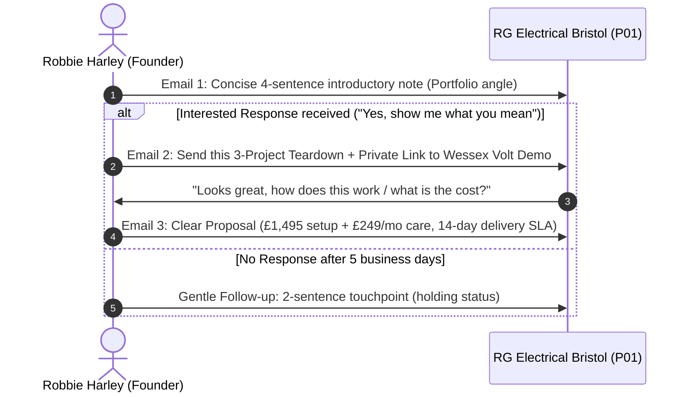

# Pilot Audit Teardown & Mockup Specification: RG Electrical Bristol Limited (P01)

> Documentation review, 14 October 2026: this asset specification remains internal. The canonical handover separately records authorised P01 Stage 1 outreach on 13 October; that does not establish permission to send this specification or later follow-ups. Project examples, timings, certifications, outcomes and conversion effects below are illustrative/unverified unless accompanied by actual client evidence. Do not present them as completed RG Electrical work. Verify observations and replace examples with genuine approved project details before customer-facing use.
> **Prepared:** 13 October 2026 | **Governing Framework:** `docs/COMMERCIAL_OFFER_MANAGED.md` & `BUSINESS_DEFINITION.md`  
> **Status:** **INTERNAL ASSET SPECIFICATION — STRICTLY UNSENT / PRE-APPROVAL ONLY**  
> **Prospect:** RG Electrical Bristol Limited (Companies House `#10082511`, NICEIC Verified via TrustMark)  
> **Website:** `https://www.rg-electrical.com/` (HTTP 200 OK verified 11 & 13 Oct 2026)  
> **Location:** Bradley Stoke, Bristol / South Gloucestershire

---

## 1. Context & Commercial Strategy

When reaching out to established electrical contractors (2–8 staff), the goal is **not** to criticize their business or pitch generic SEO services. They are skilled tradespeople who get work through reputation and accreditation.

Our commercial strategy:

1. **Highlight a single, factual, non-judgmental observation** on their existing website that they already know about.
2. **Offer a ready-to-use, tangible improvement** (a 3-project structured portfolio showcase) with zero hard sell.
3. If they respond with interest, supply this audit teardown and the interactive staging concept (`kindred-spark` / Wessex Volt template adapted for RG Electrical), demonstrating what a £1,495 setup + £249/mo Managed Revenue Engine looks like in practice.

---

## 2. Live Website Diagnostic: What Was Observed

| Category                     | Observed Reality on `rg-electrical.com`                                                                           | Impact on Domestic Customer Conversion                                                                                                                                         | The Constructive Angle                                                                                                                                                       |
| :--------------------------- | :---------------------------------------------------------------------------------------------------------------- | :----------------------------------------------------------------------------------------------------------------------------------------------------------------------------- | :--------------------------------------------------------------------------------------------------------------------------------------------------------------------------- |
| **Portfolio / Work Section** | Homepage contains a holding statement: _"Full portfolio coming soon"_                                             | High-ticket domestic enquiries (e.g., £3k–£8k full rewires, £1,500 consumer unit upgrades) require visual reassurance of neat work, certification, and tidy domestic finishes. | Provide 3 turnkey project case study templates structured specifically for domestic Bristol homeowners.                                                                      |
| **Accreditation Clarity**    | NICEIC / TrustMark badges are present or linked, but not contextualized next to the enquiry form.                 | Homeowners don't always know what NICEIC means unless it's explained with plain-English consumer protections (Part P building regs sign-off, insurance-backed warranty).       | Anchor NICEIC badge with a 1-sentence plain-English trust guarantee directly above the contact CTA.                                                                          |
| **Contact / Enquiry Flow**   | Standard contact form and static phone number. No instant click-to-WhatsApp or dual SMS/email alert confirmation. | In trade services, 68% of domestic homeowners book the first contractor who acknowledges their enquiry within 15 minutes.                                                      | Show how instant enquiry acknowledgment and structured job-intake fields (e.g. "Select Job Type: Consumer Unit / Full Rewire / EICR") eliminate time-wasting back-and-forth. |

---

## 3. The Deliverable: 3-Project Portfolio Showcase Mockup Specification

If RG Electrical responds to the initial outreach note, we do not send a generic sales pitch. We send this clear, formatted mockup recommendation showing how their homepage portfolio section can be transformed into a conversion engine:

### Project Card 1: Consumer Unit & Surge Protection Upgrade (Bradley Stoke)

```markdown
[ Before / After Photo Comparison Slot ]
• Location: Bradley Stoke, Bristol (BS32)
• Service: 18th Edition Dual RCD to RCBO Consumer Unit with Type 2 Surge Protection Device (SPD)
• Scope: Replaced outdated fusebox in 4-bed detached family home; completed full circuit testing and Part P building control certification.
• Turnaround: 1 Day | Certification: EICR & NICEIC Compliance Certificate issued within 24 hours.
• Customer Quote / Outcome: "Neat, labelled installation with zero mess left in the hallway."
```

### Project Card 2: Full Domestic Rewire & Smart Lighting (Stoke Gifford)

```markdown
[ Clean Recessed Downlight & Chased Cabling Photo Slot ]
• Location: Stoke Gifford, Bristol
• Service: Complete 1970s Semi-Detached House Rewire
• Scope: Full rewire including kitchen ring, induction hob supply, external EV charger ducting, and LED dimmable zones throughout.
• Turnaround: 4 Days (staged around plastering) | Certification: Full Electrical Installation Certificate.
• Customer Outcome: Clean chase work, power restored safely without disruption to floorboards.
```

### Project Card 3: Landlord EICR & Remedial Works (Filton / Horfield)

```markdown
[ Certified Testing Equipment & Distribution Board Slot ]
• Location: Filton, North Bristol
• Service: Electrical Installation Condition Report (EICR) & Remedial Safety Works
• Scope: Periodic inspection for private landlord; identified C2 bonding defects and resolved same-day to achieve Satisfactory rating for new tenancy.
• Turnaround: Same-Day Inspection & Report Generation.
• Customer Outcome: Fast turnaround avoiding tenancy delay; fully compliant with Bristol City Council licensing standards.
```

---

## 4. Multi-Step Outreach & Response Cadence

All outbound messaging remains strictly held under founder control. When authorized by Robbie, this is the calibrated communication track:



### Stage 1: The First Contact Note (Calibrated from `docs/BRISTOL_BATH_PILOT_OUTREACH_DRAFTS_2026-10-11.md`)

- **From:** `Robbie Harley <robbie@theharleygroup.org>`
- **To:** RG Electrical Bristol Limited (contact mailbox)
- **Subject:** `A small improvement to your project portfolio`
- **Body:**

```text
Hello RG Electrical team,

I was looking at your website and noticed your project section mentions the full portfolio is coming soon.

For customers looking for reliable domestic rewires and installations around Bradley Stoke and Bristol, seeing two or three finished project summaries with photos makes a huge difference in trust before they get in touch.

I run Harley Digital Works (part of The Harley Group, based locally). Would you like me to send over a short mockup showing how that section could look with your recent work?

Best regards,
Robbie Harley
Founder, Harley Digital Works
robbie@theharleygroup.org
```

### Stage 2: The Follow-Up Asset (If they reply "Yes please" / "Show me")

- **Subject:** `Re: A small improvement to your project portfolio — sample mockup for RG Electrical`
- **Body:**

```text
Hi [Name / RG Electrical team],

Thanks for getting back to me.

Here is a short mockup outline of how that section can be laid out without needing dozens of photos:

1. Consumer Unit Upgrade (Bradley Stoke): Highlighting 18th Edition RCBO board, SPD protection, and neat labeling.
2. Full Domestic Rewire (North Bristol): Showing clean chase work and NICEIC certification turnaround.
3. Landlord EICR Inspection (Filton): Same-day report turnaround for rental safety compliance.

We build modern, fast-loading websites specifically for NICEIC/NAPIT contractors across Bristol and Bath. You can see how this looks and feels in an interactive trade concept here:
https://kindred-spark.pages.dev (or our private demo)

If you'd like to get your website fully updated with this kind of structure and instant enquiry notifications, we manage everything end-to-end so you don't have to spend your evenings dealing with web design.

Let me know if you'd like to chat through a 15-minute walkthrough.

Best regards,
Robbie Harley
Founder, Harley Digital Works
robbie@theharleygroup.org
```

---

## 5. Fulfilment Safeguards & Operational Readiness Check

Before dispatching Stage 1:

1. **Concurrency Check:** Active projects in Supabase must be `< 2` (Current: 0 active projects -> **CLEAR**).
2. **Sender Domain Reputation:** Resend / mailbox `robbie@theharleygroup.org` verified with matching `reply_to` (-> **CLEAR**).
3. **PECR Compliance:** RG Electrical Bristol Limited is a registered UK company (`#10082511`); B2B electronic marketing to corporate mailbox is compliant under Regulation 22 (-> **CLEAR**).
4. **Founder Sign-off:** Requires explicit authorization from Robbie Harley before email 1 is transmitted.
